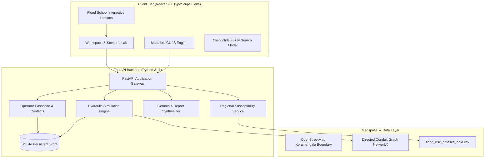

# PRAVAHA: Urban Flood Intelligence & Drainage Network Investigation

[](https://github.com/pravaha-urban/pravaha/actions/workflows/ci.yml)
[](LICENSE)
[](https://python.org)
[](https://nodejs.org)
[](https://www.w3.org/WAI/standards-guidelines/wcag/)

**PRAVAHA** (Sanskrit for *Flow* / *Current*) is an urban flood intelligence, drainage network modeling, and infrastructure screening platform tailored for the Koramangala catchment in Bengaluru, Karnataka, India.

Engineered with a restrained, mission-critical interface, PRAVAHA pairs deterministic hydraulic network simulation with real-time scenario modeling, multi-factor bottleneck ranking, regional susceptibility analysis, interactive engineering education, and Google Gemma 4 technical narrative generation with strict evidence-grounding constraints.

---

## Architecture Overview



---

## Key Modules & Capabilities

### 1. Deterministic Hydraulic Simulation Engine
- **Runoff Formulation**: Evaluates surface runoff generation using the Rational Formula:
  $$Q = \frac{C \cdot I \cdot A}{360}$$
  where $Q$ is peak flow ($\text{m}^3/\text{s}$), $C$ is the composite runoff coefficient (0.25 to 0.90 depending on land use), $I$ is rainfall intensity ($\text{mm/h}$), and $A$ is the catchment surface area ($\text{ha}$).
- **Capacity Routing**: Routes runoff topologically through a directed graph of 27 stormwater conduits aligned with Koramangala's street network and terrain slope toward Agara Lake.
- **Dynamic Timeline Scrubber**: Discretizes storms into timesteps over a synthetic bell-shaped intensity hydrograph.
- **Hotspot Geometry**: Automatically generates spatial overload polygons around conduits exceeding conveyance capacity ($Q / Q_{\text{cap}} > 1.0$).

### 2. Multi-Factor Bottleneck Ranking
Ranks urban drainage choke points using exposed, configurable factor weights:
- **Exceedance Severity ($40\%$)**: Ratio of peak routed flow to hydraulic capacity.
- **Upstream Catchment Area ($25\%$)**: Contributing drainage territory relying on this conduit.
- **Downstream Connectivity Constraint ($20\%$)**: Capacity ratio compared to immediate downstream discharge pipes.
- **Civic Criticality ($15\%$)**: Proximity to major arterial roads, hospitals, bus depots, and educational hubs.
- **Intervention Comparison**: Live delta computation between baseline scenarios and proposed cleanouts, capacity expansions, or retention interventions.

### 3. Regional Susceptibility Analysis & ML Pipeline
- **Dataset**: Built from `flood_risk_dataset_india.csv` (50,000 national records across 50 Indian districts).
- **Scientific Integrity & Provenance**: Full disclosure documented in [`docs/DATASET_REPORT.md`](docs/DATASET_REPORT.md). Synthetic artifacts (uniform continuous distributions and balanced class distribution) are prominently presented in the UI to prevent ungrounded operational claims.
- **Dual Interpretable Models**:
  - Regularized Logistic Regression with odds-ratio coefficients.
  - Gradient Boosted Decision Trees (GBDT) with feature importances.
  - Interactive prediction playground with real-time inference and factor influence visualization.

### 4. Google Gemma 4 Technical Narrative Synthesis
- **Model**: Google Gemma 4 (`google/gemma-4-E4B-it`) via OpenAI-compatible endpoints.
- **Strict Evidence Citation**: Enforces that all assertions cite validated computation IDs (e.g., `[EVID-SIM-01]`, `[EVID-DS-04]`).
- **Anti-Hallucination Depth Guardrails**: Rejects any hallucinated water depths or ungrounded centimeter claims not calculated by the deterministic hydraulic solver.
- **Deterministic Offline Fallback**: Generates structured, deterministic reports when remote LLM inference is disabled or unreachable.

### 5. Interactive Educational Layer ("Flood School")
Six interactive engineering lessons with live parameter sliders and self-check quizzes:
1. *The Rational Method & Urban Runoff ($Q = CIA/360$)*
2. *Manning's Flow & Conduit Conveyance Capacity*
3. *Network Bottlenecks & Upstream Surcharge Dynamics*
4. *Visual Drainage Inspection & Siltation Assessment*
5. *Hydraulic Modeling Assumptions & Real-World Caveats*
6. *Regional Susceptibility & Tabular Machine Learning*

---

## Local Development Quickstart

### Prerequisites
- Python 3.10+ (Tested up to Python 3.14)
- Node.js 18.0+ or 20.0+ (npm 9+)
- Git

### 1. Clone Repository & Setup Backend
```bash
git clone https://github.com/pravaha-urban/pravaha.git
cd pravaha

# Create and activate Python virtual environment
python3 -m venv .venv
source .venv/bin/activate  # On Windows: .venv\Scripts\activate

# Install dependencies
pip install --upgrade pip
pip install -r backend/requirements.txt

# Run initial data profiling & network generation
python backend/scripts/profile_dataset.py
python backend/scripts/prepare_spatial_data.py
```

### 2. Start Backend API
```bash
uvicorn backend.app.main:app --host 127.0.0.1 --port 8000 --reload
```
The interactive OpenAPI documentation will be available at `http://127.0.0.1:8000/docs`.

### 3. Setup & Start Frontend
In a new terminal window:
```bash
cd frontend
npm install
npm run dev
```
Open your browser at `http://127.0.0.1:5173`.

---

## Automated Testing Suite

PRAVAHA enforces end-to-end testing across both backend and frontend.

### Backend Tests (80 Pytest Tests)
```bash
# From workspace root
python3 -m pytest backend/tests -v
```
Test suites cover:
- Data integrity, dataset profiling, and GeoJSON validity
- Deterministic simulation calculations, golden fixture verification, and boundary conditions
- Bottleneck scoring and intervention ranking
- Regional susceptibility ML inference and validation bounds
- Gemma 4 report generation, evidence ID validation, and hallucination guardrails
- Contact submissions and operator passcode authentication

### Frontend Tests (46 Vitest Tests & Production Build)
```bash
cd frontend
npm run test       # Runs Vitest unit and component tests
npm run build      # Runs TypeScript compilation (tsc -b) and Vite bundle
```
Test suites cover:
- Client-side TypeScript Rational Method parity with Python golden fixtures
- Scenario simulation state and timeline scrubber
- Bottleneck calculation and intervention diffing
- Component rendering, modals, and regional risk factors

---

## Environment Variables Reference

Copy `.env.example` to `.env` to customize settings:

| Variable | Default Value | Description |
| :--- | :--- | :--- |
| `HOST` | `127.0.0.1` | Backend host bind address |
| `PORT` | `8000` | Backend port |
| `CORS_ORIGINS` | `http://localhost:5173,http://127.0.0.1:5173` | Allowed CORS origins for API requests |
| `ADMIN_PASSCODE` | `pravaha-admin-secret-2026` | Passcode for operator panel access |
| `GEMMA_BASE_URL` | *(empty = deterministic fallback)* | OpenAI-compatible endpoint URL for Gemma 4 |
| `GEMMA_API_KEY` | *(optional)* | API key for remote LLM provider |
| `GEMMA_MODEL` | `google/gemma-4-E4B-it` | Model identifier |
| `DATASET_PATH` | `flood_risk_dataset_india.csv` | Relative or absolute path to risk dataset |

---

## Docker & Container Deployment

PRAVAHA includes a production-ready `Dockerfile` and `docker-compose.yml`:

```bash
# Build and launch backend container
docker compose up -d

# Verify container health
curl http://localhost:8000/api/health
```

---

## Continuous Integration & Deployment Workflows

- **`.github/workflows/ci.yml`**: Automatically runs Pytest backend tests, Vitest frontend tests, and production TypeScript builds on every pull request and push to `main`.
- **`.github/workflows/deploy-frontend.yml`**: Automatically packages and deploys the static single-page application to GitHub Pages upon merge to `main`.

---

## Accessibility & Engineering Standards

- **WCAG AA Compliance**: Tactile engineering palette (cream, sage-300, sage-500, ink, pink) with verified 4.5:1+ contrast across all text and background pairs in both light and dark themes.
- **Full Keyboard Navigation**: Visible focus rings (`focus-visible:ring-2`), logical tab index sequence, and Escape key listeners for all modals.
- **Skip-to-Content Link**: Primary landmark navigation support for screen readers.
- **Reduced Motion Support**: Automatic suppression of animations via `@media (prefers-reduced-motion: reduce)`. Native cursors only.
- **Responsive Layout**: Fluid breakpoints covering mobile (390px), tablet (768px/1024px), and desktop (1440px) viewports.

---

## Operating Scope & Notice

> **IMPORTANT SCIENTIFIC NOTICE**:
> PRAVAHA is an analytical screening and engineering decision-support tool designed for planning, scenario evaluation, and educational exploration. It is **not** an operational flood early warning system. Simulated accumulation indicators and candidate bottlenecks must not be construed as real-time field measurements or municipal alerts. In an active storm emergency, follow official municipal alerts from BBMP / NDMA and contact local disaster management services immediately.

---

## License

Distributed under the MIT License. See [LICENSE](LICENSE) for details.
